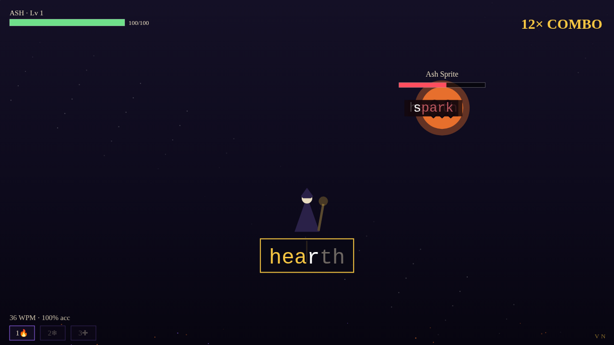

# ⌨️ Keystroke Chronicles

**Story-driven typing RPG — type to cast spells, duel ink-born monsters, and restore the Great Lexicon.**

A single-file, zero-dependency browser game. Every keystroke is a spell: type the words on screen to blast enemies, shatter incoming curses before they strike you, and channel long incantations to bring down bosses. Your accuracy shapes the story's ending.



## ✨ Features

- **6-chapter fantasy campaign** — from the Cinder Archives to the heart of the Inkblight, each chapter opens with story dialogue and ends in a boss duel
- **ZType-style combat** — keystrokes auto-route to the matching word; no target-switching, just flow
- **Enemy curses** — foes hurl words at you on timers; type them in time or take the hit
- **Boss channels** — long incantation passages with a countdown; complete one to deal massive damage and stun the boss
- **Spell system** — 🔥 Fireball (10-combo), ❄️ Frost Nova (20-combo freeze), ✚ Mend (heal, unlocked by 95%+ chapter accuracy)
- **Combo multiplier** — mistakes break your combo and empower the enemy's backlash
- **Live WPM + accuracy HUD**, per-battle report cards, and level-up choices between chapters
- **3 endings** — Dawnbringer, Ashen, and the secret Inkbound ending, earned by performance
- **3 difficulties** (Scribe / Leximancer / Archmage), screen-shake toggle, dialogue text speed
- **Full menu suite** — title (New / Continue / How to Play), pause (Resume / Restart / Mute / Quit), settings
- **LocalStorage saves** — continue your campaign across sessions
- **Maximalist SFX/VFX** — fully synthesized WebAudio sound set, particle bursts, screen shake, damage flashes, level-up fanfares
- **VN-signed** — look for the mark in the corner

## 🚀 Play

No build step. Just open `index.html` in a browser — or serve it:

```bash
npx serve .
# or
python3 -m http.server
```

Keyboard-first: type letters to cast, `1`/`2`/`3` for spells, `Esc` to pause.

## 🛠 Tech

Vanilla HTML5 + CSS + JS in a single `index.html`. Canvas renderer, WebAudio-synthesized SFX (zero audio assets), `localStorage` persistence. No dependencies, no build, no network calls.

See [PLAN.md](PLAN.md) for the architecture, UI/UX thinking, and the bug-mitigation log from development.

## 📜 License

MIT — see [LICENSE](LICENSE). Made by Vivek Nair · **VN**
